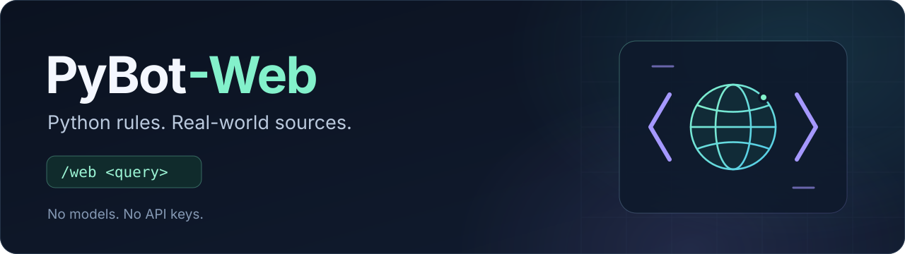
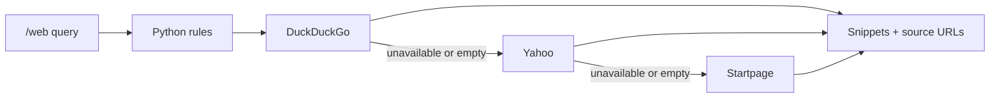

<p align="center">
  
</p>

<p align="center">
  <a href="#quick-start"></a>
  
  <a href="LICENSE"></a>
</p>

<p align="center">
  <strong>A Python chatbot with on-demand web search.</strong><br>
  No LLM inference. No model downloads. No API keys.
</p>

<p align="center">
  <a href="#quick-start">Quick start</a> &middot;
  <a href="#the-web-command">The /web command</a> &middot;
  <a href="#search-modes">Search modes</a> &middot;
  <a href="#how-it-works">How it works</a>
</p>

---

PyBot-Web builds on [Hugging Face's PyBot](https://github.com/huggingface/pybot), keeping its Python rules, lookup tables, and conversation memory while adding internet search through [`ddgs`](https://github.com/deedy5/ddgs).

**Chat normally. Type `/web <query>` when you want to search.** Automatic searches are off by default.

| Search on your terms | Sources with every result | Original Python rules |
|---|---|---|
| Use `/web` for a single lookup, or opt into automatic searches. | Up to three titles, short snippets, and source URLs. | Local calculations, everyday advice, and conversation recall keep working. |

## Quick start

Use **Python 3.10+** for web search. These commands use a virtual environment directly, so activation is optional.

<details open>
<summary><strong>Windows / PowerShell</strong></summary>

```powershell
git clone https://github.com/simoneprezioso/pybot-web.git
cd pybot-web
python -m venv .venv
.\.venv\Scripts\python.exe -m pip install ".[web]"
.\.venv\Scripts\python.exe -m pybot
```

</details>

<details>
<summary><strong>macOS / Linux</strong></summary>

```sh
git clone https://github.com/simoneprezioso/pybot-web.git
cd pybot-web
python3 -m venv .venv
.venv/bin/python -m pip install ".[web]"
.venv/bin/python -m pybot
```

</details>

<details>
<summary><strong>Already cloned? Update your existing folder.</strong></summary>

Exit any running chat with `/exit`, then run from the repository folder:

```powershell
git pull --ff-only
.\.venv\Scripts\python.exe -m pip install ".[web]"
.\.venv\Scripts\python.exe -m pybot
```

On macOS/Linux, use `.venv/bin/python` in place of `.\.venv\Scripts\python.exe`. Create the virtual environment first if it does not exist. There is no need to clone the repository again.

</details>

Once the chat opens, try:

```text
/web AI news
/web pancake recipe
/web what to do in Rome
```

The module and command names remain `pybot` for compatibility. Installing this repository also provides a `pybot` console command.

## The /web command

| In the chat | What happens |
|---|---|
| `/web AI news today` | Search for recent AI news and return linked excerpts. |
| `/web pancake recipe` | Search explicitly, even if the local bot knows about pancakes. |
| `/web` | Show usage without searching, unless web requests are explicitly disabled. |
| `What is 2 + 2?` | Use the existing local calculator. |
| `/help` | Show interactive chat commands. |
| `/reset` | Start a new conversation; clear the screen in a terminal. |
| `/exit` | Quit the interactive chat. |

`/web` also works in one-shot and piped modes. In the examples below, use your virtual environment's Python executable:

```sh
python -m pybot -p "/web AI news today"
echo "/web pancake recipe" | python -m pybot
```

A reply includes result titles, excerpts, and links. This is an **illustrative format**, not a captured live result:

```text
Search results for "example query" (snippets, not independently verified):
[1] Example title: An excerpt from the search result. Source: https://example.org/page
```

CLI replies are printed on one line, including in piped mode.

> [!NOTE]
> Search snippets are excerpts, not verified answers. They can be stale or contradictory. PyBot-Web does not fetch the linked pages or use an LLM to synthesize an answer. Check the source links for confirmation.

## Search modes

| Mode | Start option | Behavior |
|---|---|---|
| **On demand** | No extra flag | Ordinary conversation stays local. `/web <query>` makes one explicit search. |
| **Automatic** | `--web-search` | Supported current-information questions can search automatically. `/web` remains available. |
| **Offline** | `--no-web-search` | Block every web request, including `/web`. No search package is imported. |

For example:

```sh
python -m pybot --web-search -p "Who is the current CEO of Microsoft?"
python -m pybot --no-web-search
```

Automatic routing recognizes a limited set of question forms about company leaders, news, weather, market prices, and software releases. Named-person questions can search when local knowledge has no answer. Arithmetic, dates, cooking advice, greetings, and conversation recall stay local. Emergency responses and ongoing safety threads also stay local.

Older phrases such as "search the web for ..." remain supported in automatic mode. `/web` is the direct command for on-demand searches.

<details>
<summary><strong>Environment settings and CLI reference</strong></summary>

Enable automatic search in PowerShell:

```powershell
$env:PYBOT_WEB_SEARCH = "1"
.\.venv\Scripts\python.exe -m pybot
```

Or on macOS/Linux:

```sh
export PYBOT_WEB_SEARCH=1
.venv/bin/python -m pybot
```

| `PYBOT_WEB_SEARCH` | Effect |
|---|---|
| Unset or empty | Automatic search off; `/web` available. |
| `1`, `true`, `yes`, `on` | Enable automatic routing, ignoring case. |
| `0`, `false`, `no`, `off` | Disable all web requests, including `/web`. |

CLI flags override the environment for the current invocation and restore its previous value when `main()` returns. The environment setting also works with `python -m bot` and `bot.runtime.reply`.

| CLI option | Purpose |
|---|---|
| `-p TEXT`, `--prompt TEXT` | Reply to one message and exit. |
| `-i`, `--interactive` | Keep chatting after the initial `-p` message. |
| `-s N`, `--seed N` | Seed local wording choices; live results can still change. |
| `-v`, `--verbose` | Show the selected module and elapsed time. |
| `--web-search` | Enable automatic search routing. |
| `--no-web-search` | Block all web requests. |

</details>

## How it works

The search module joins PyBot's existing response pipeline. The original runtime and arbiter are unchanged; all routing and response formatting remain Python rules.



Search stops at the first provider that returns usable results. Disabled or unavailable providers are skipped. The adapter checks the installed `ddgs` provider registry and never switches to unrestricted automatic provider selection.

<details>
<summary><strong>Architecture and source map</strong></summary>

Every turn runs shared `observe` hooks, collects `respond` proposals on isolated memory copies, and lets the arbiter choose a reply. The chosen memory copy is retained, `after` hooks run, and the runtime records the turn.

| Path | Responsibility |
|---|---|
| [`bot/modules/web_search.py`](bot/modules/web_search.py) | `/web`, configuration, routing, safety checks, and excerpt formatting. |
| [`bot/search.py`](bot/search.py) | Optional `ddgs` adapter, provider fallbacks, result cleanup, and errors. |
| [`bot/runtime.py`](bot/runtime.py) | Original module discovery and turn pipeline. |
| [`bot/modules/arbiter.py`](bot/modules/arbiter.py) | Original response selection. |
| [`bot/modules/answers.py`](bot/modules/answers.py) | Existing calculations and knowledge-base answers. |
| [`pybot.py`](pybot.py) | CLI and interactive chat. |
| [`tests/`](tests/) | CLI, adapter, routing, and response-pipeline tests. |

The search module uses existing arbiter claim hooks at a priority below the safety band. The hooks perform no network requests. Before searching, existing emergency rules are checked on an isolated memory copy while preserving random state.

</details>

## Requirements and limits

- **Web search:** Python 3.10+ and `ddgs>=9,<10`, installed with `.[web]`.
- **Local chat:** Python 3.8+ and the standard library. The `web` extra skips `ddgs` on Python 3.8 and 3.9.
- **Availability:** this is an unofficial integration. Providers can throttle, block requests, or return no results. PyBot-Web does not bypass CAPTCHAs.
- **Timeouts:** at most three provider attempts, each with a five-second client timeout. The entire turn can take longer; this is not a whole-turn deadline.
- **Privacy:** an explicit `/web` request or an eligible automatic query may send query text to the available DuckDuckGo, Yahoo, and Startpage providers, in that order.

If no provider returns usable results, the bot reports the failure. It does not invent an answer. Installing the search dependency alone does not send ordinary messages to the internet.

## Testing

```sh
python -m unittest discover -s tests
```

Automated search calls are mocked. Tests need neither internet access nor `ddgs` and cover `/web`, provider fallbacks, local responses, errors, timeouts, source formatting, safety precedence, conversation memory, and CLI configuration.

## Credits and license

Built on [Hugging Face's PyBot](https://github.com/huggingface/pybot). This fork adds the search command, optional automatic routing, provider fallbacks, configuration, and tests. The [upstream demo](https://huggingface.co/spaces/HuggingFaceSwarms/PyBot) demonstrates the original bot.

Licensed under [Apache 2.0](LICENSE).
